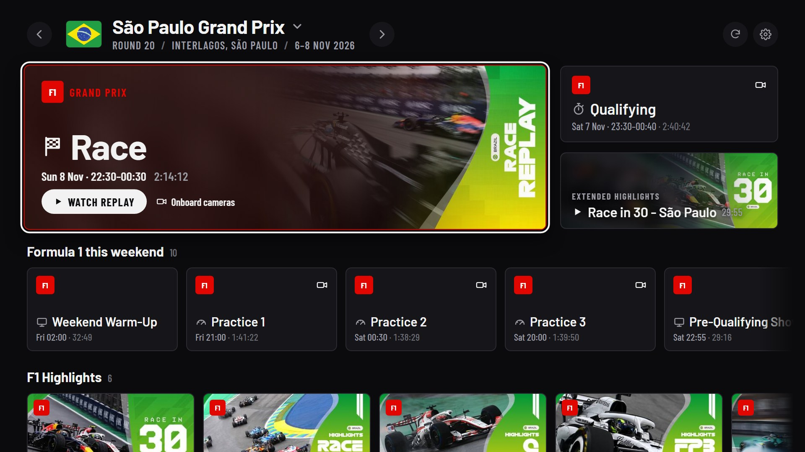
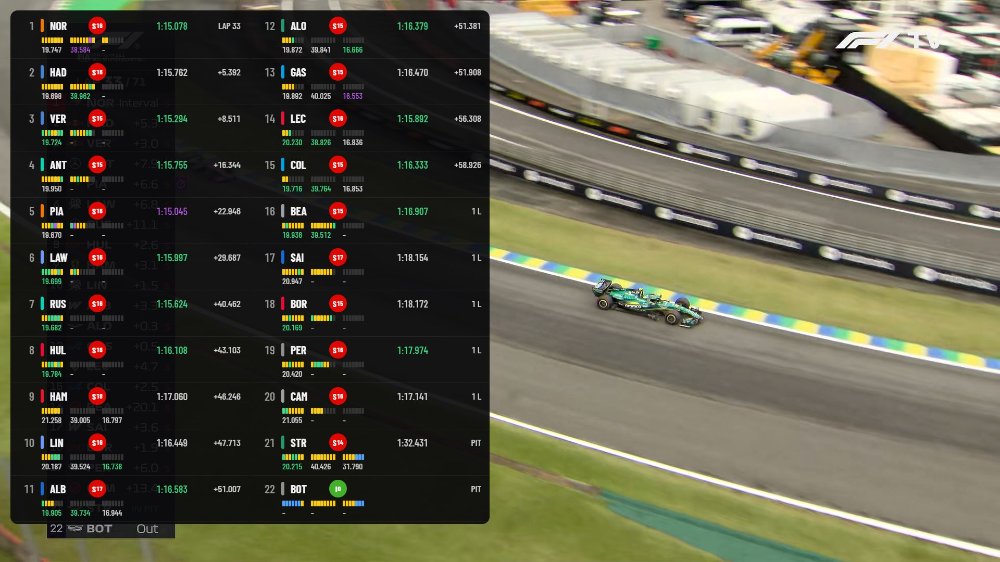
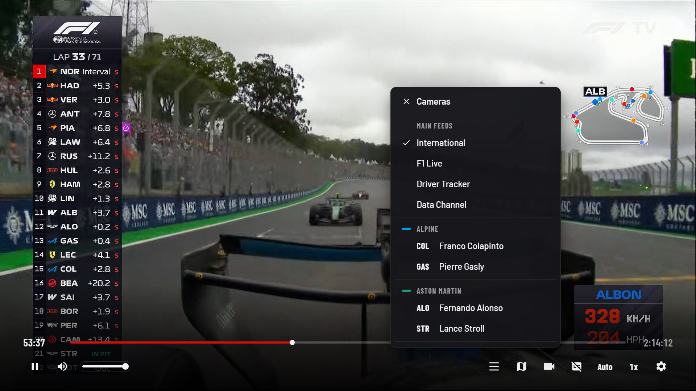
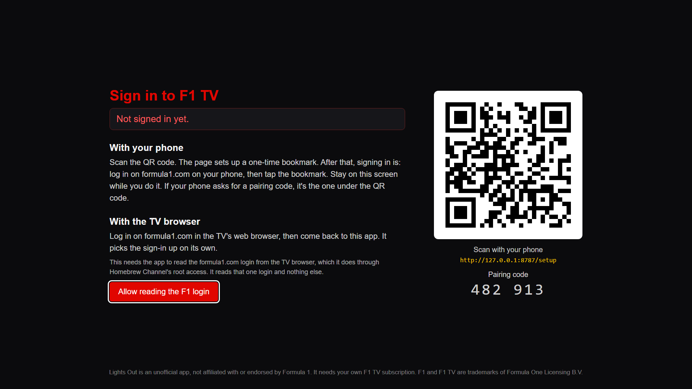

# Lights Out for F1 TV

An F1 TV player for LG webOS TVs, installed through the
[webOS Homebrew Channel](https://www.webosbrew.org/). Watch live sessions and
replays from your own F1 TV subscription, switch between the world feed and
the onboard cameras, and bring up a live timing tower and track map over the
video.

> **Unofficial.** Lights Out is not affiliated with or endorsed by Formula 1,
> F1 TV or LG. It needs your own F1 TV subscription and plays only what that
> subscription includes. F1 and F1 TV are trademarks of Formula One
> Licensing B.V.

## Features

- **Browse** race weekends by season: the current weekend's schedule,
  replays, shows and the support series.
- **Every camera** F1 TV offers for a session: the international feed, the
  F1 Live show, the data and tracker channels and each driver's onboard,
  switched without losing your place in a replay.
- **Timing tower**: positions, gaps, sectors, tyres and the last lap,
  from F1's live timing feed during a session. For replays it's rebuilt
  from F1's session archive. Either way it's lined up with the moment on
  screen, and Settings > Timing delay fine-tunes it.
- **Track map**: car positions drawn from live telemetry.
- Audio languages, subtitles, quality and playback speed, all from the
  remote. Replays resume where you left off.

## Screenshots









## Requirements

- An LG TV running webOS with the [Homebrew Channel](https://www.webosbrew.org/)
  installed. Root is not required.
- An F1 TV subscription. Live sessions and onboard cameras need F1 TV Pro or
  Premium.

## Install

Open Homebrew Channel on the TV, find **Lights Out for F1 TV** and install it.

## Signing in

F1's login page only works in a real browser, so the TV can't log in by
itself. Instead you hand it a login from a browser, about once a month:

1. Open Lights Out. The sign-in screen shows a QR code and a pairing code.
2. Scan the QR code with your phone. The page that opens walks you through
   adding a one-time bookmark.
3. Log in on formula1.com on your phone, then tap that bookmark. The TV
   picks the sign-in up within a few seconds.

The bookmark needs Firefox for Android or a desktop browser. Chrome and Edge
on Android refuse to run bookmarks like it.

F1 TV issues 4-day passes, and the app renews them by itself from the
login's session. The session lasts at least 30 days, so a monthly visit to
the bookmark is enough.

**On a rooted TV** the sign-in screen can also offer to read your login
straight from the TV's own web browser, through Homebrew Channel's root
access. It's off until you allow it, and it reads only the formula1.com
login.

The sign-in page on the TV's network address needs the pairing code, so
nobody else on your network can see or change the TV's sign-in.

The sign-in is kept inside the app's own folder on the TV. Updates keep it,
and uninstalling the app deletes it.

## Known limits

- **One video at a time.** The TVs this was built on decode a single
  protected stream reliably, so there's no multiview.
- **The track map builds up as cars drive.** F1 doesn't publish circuit
  shapes, so the outline appears from the cars' own positions over the
  first laps.
- F1 TV's interfaces aren't public. If F1 changes them, parts of the app can
  stop working until an update follows. Please report it (see below).

## Reporting problems

[Open an issue](https://github.com/The-DarkMatter/lightsout-webos/issues/new/choose)
with your TV model, its webOS version, the app version, and what happened.

## How it works

- **An on-TV service does the talking.** F1's servers send no CORS headers,
  so a webOS app's pages can't call them. A small Node service inside the
  package (`service/`) makes every F1 call, and the pages
  (`app/`) reach it over webOS's Luna bus.
- **A token, not a password.** F1's login is behind a bot check that only
  clears in a real browser, so sign-in hands over the token a browser login
  produces (`service/lib/auth.js`). The token carries a longer-lived session,
  and F1's own account API swaps that session for fresh tokens.
- **Playback** uses [Shaka Player](https://github.com/shaka-project/shaka-player)
  with the TV's own Widevine support for live streams. Nothing about the
  protection is bypassed: the licence request carries your own sign-in.
- **Timing** comes from F1's live timing feed while a session runs
  (`service/lib/livetiming.js`), and for replays from F1's session archive
  (which uses your sign-in), lined up with the video by the timestamps in F1 TV's streams
  (`service/lib/archive.js`).

## Development

You need Node.js. On a PC:

```sh
node scripts/dev-server.js --mock   # canned data, no sign-in, no network
node scripts/dev-server.js          # the real service against F1 TV
```

Then open <http://localhost:8788/browse.html>. Real mode prints a sign-in
link with its pairing code; the sign-in screen in the browser takes a pasted
`login-session` cookie from formula1.com. `dev/mocks.js` lists the preview
switches for mock mode.

To build the IPK you need [ares-cli](https://github.com/webos-tools/cli)
(`npm install -g @webos-tools/cli`):

```sh
bash scripts/package.sh                # builds build/<id>_<version>_all.ipk
bash scripts/deploy.sh [device]        # builds, installs and launches over SSH
```

Releases are built by GitHub Actions from a `v<version>` tag
(`.github/workflows/release.yml`).

### Older TVs (webOS 4)

The normal package needs webOS 7 or later. On webOS 4 the service runs on
Node 0.12 and the app on Chrome 53, and the stock build breaks on both.
`legacy/make.sh` builds a separate package for those TVs from the same
`app/` and `service/`:

```sh
legacy/make.sh                         # builds build/legacy/out/<id>_<version>_all.ipk
```

It changes the copies, not the sources:

- The service gets `legacy/service-compat.js` (`Object.assign`,
  `Buffer.from`, `fs.mkdirSync` with `recursive`, request timeouts), ws
  1.1.5 in place of ws 8, and the TV's own `webos-service` in place of the
  pinned one.
- The app gets `legacy/app-compat.js` (a few ES2017 shims, and
  `scrollIntoView` options), and `legacy/build.js` turns flex `gap`, `inset`
  and `aspect-ratio` into CSS that Chrome 53 understands.

`legacy/lightsout-renew.sh` is an optional Homebrew boot hook for rooted
TVs. It wakes the service every six hours so the 4-day pass gets renewed
even when nobody opens the app, and shows a toast once a day during the
last two weeks of the sign-in.

Tested on an LG webOS 4.10 TV (Node v0.12.2): the service, sign-in,
renewal, season browsing and live timing. Playback on webOS 4 is not
tested yet.

## AI assistance

This app was written with the help of AI coding agents. The author has
reviewed the code and tested it on an LG C5 (webOS 25).

## Licence

Apache License 2.0, see [LICENSE](LICENSE). Bundled third-party components
and their licences are listed in [THIRD_PARTY.md](THIRD_PARTY.md).
